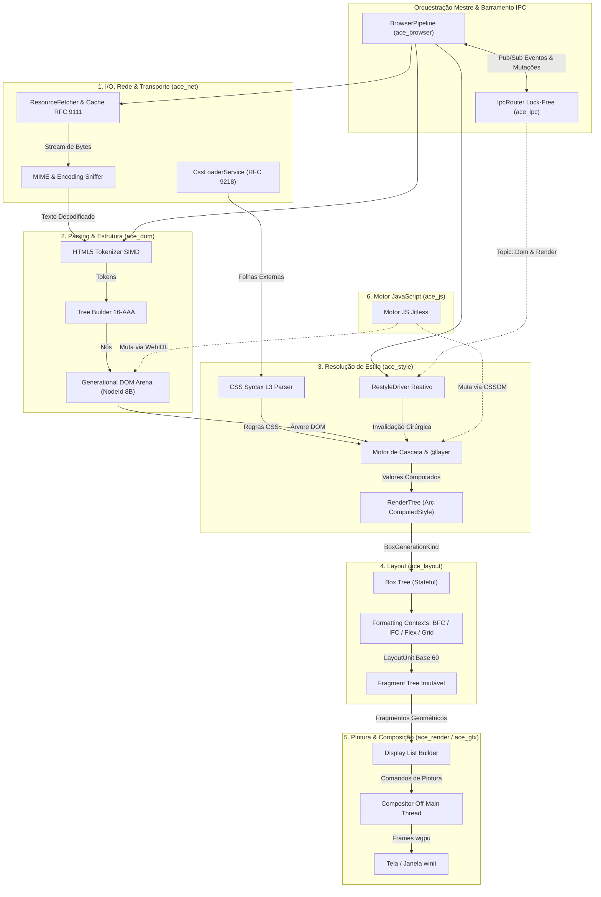

# 🏛️ Central de Arquitetura — Albedo Core Engine (ACE)

> **Diretório:** `docs/architecture/`  
> **Status:** Ativo & Sincronizado (Alinhado com o [PLANO.md v7.1](../../PLANO.md))  
> **Propósito:** Centralizar as especificações técnicas aprofundadas (*Engineering Master Plans*) de cada subsistema do motor ACE.

---

## 🧭 Pipeline Geral do Motor (End-to-End)

O fluxo de processamento de uma página web no Albedo segue um pipeline unificado orquestrado pelo `BrowserPipeline` (`ace_browser`) e coordenado pelo barramento de comunicação assíncrono `IpcRouter` (`ace_ipc`), projetado para execução concorrente, reatividade cirúrgica e alto desempenho:

---

## 📚 Especificações Técnicas dos Subsistemas

| Subsistema | Documento de Arquitetura | Fase no PLANO | Status | Responsabilidade Principal |
| :--- | :--- | :---: | :---: | :--- |
| **`ace_core`** | [**`ace_core.md`**](./ace_core.md) | Fase 2 | ✅ Concluído | Arenas geracionais com EBR, `Option<NodeId>` em 8B, `TripleBuffer` lock-free, matemática `euclid`, aritmética `LayoutUnit` (base 60), cores CSS Color 4 e Event Loop WHATWG (530 testes verdes). |
| **`ace_ipc`** | [**`ace_ipc.md`**](./ace_ipc.md) | Fase 2 / Transversal | ✅ Concluído | Barramento lock-free in-process (>2.22M msg/s), bounded ring-buffer, `IpcRouter` Pub/Sub multi-tópico thread-safe e protocolo normativo `IpcMessage` (#![forbid(unsafe_code)]). |
| **`ace_net`** | [**`ace_net.md`**](./ace_net.md) | Fase 3 | ✅ Concluído | `ResourceFetcher`, Cache RFC 9111 L1/L2 com WAL, DoH Happy Eyeballs v2, Cookies CHIPS, `CriticalResourceScheduler` RFC 9218 e `CssLoaderService` (213 testes verdes). |
| **`ace_dom`** | [**`ace_dom.md`**](./ace_dom.md) | Fase 5 | ✅ Concluído | Tokenizer HTML5 SIMD, Tree Builder com 16-AAA, seletores CSS4 com Ancestor Bloom Filter de 64 buckets, DSD, `StreamingHtmlParser` e suíte oficial `html5lib-tests` (252 testes verdes). |
| **`ace_style`** | [**`ace_style.md`**](./ace_style.md) | Fase 6 | ✅ Concluído | CSS Syntax L3, RuleBucketMap, cascata de 8 origens + @layer, VariableResolver DAG anti-cycle, Style Structs imutáveis, MPC, `RestyleDriver` reativo e `RenderTree` (25 testes verdes). |
| **`ace_browser`** | [**`ace_browser.md`**](./ace_browser.md) | Fase 6 / Transversal | ✅ Concluído | Orquestrador mestre `BrowserPipeline`: ciclo unificado URL -> Stream -> DOM -> CSSOM -> Style -> RenderTree -> Frame IPC e reestilização reativa incremental. |
| **`ace_layout`** | [**`ace_layout.md`**](./ace_layout.md) | Fase 7 | 🎯 Especificado | Engenharia preliminar: Box Tree vs Fragment Tree imutável (LayoutNG), BFC, IFC, Flexbox, Grid, ponto fixo base 60 (`LayoutUnit`) e geometria lógica tipada via `euclid 0.22`. |
| **Infra de Testes** | [**`test_infra.md`**](./test_infra.md) | Transversal | ✅ Ativo | Arquitetura 4-Tier para baixo nível e estratégia em 4 estágios para o consórcio Web Platform Tests (WPT). Total consolidado: **1.024 testes verdes em 181 suítes**. |

---

## ⚖️ Convenções Inegociáveis de Arquitetura

1. **Paradigma Pragmático (Regra 1):** O motor web é 100% nosso (*Alma*), enquanto a infraestrutura reutiliza crates maduras e auditadas do ecossistema Rust (*Fundações*). É terminantemente proibido incorporar motores pré-fabricados (Blink, Gecko, Servo, V8, etc.).
2. **Matriz Hierárquica de Dependências:** Nenhum crate pode depender de uma camada superior no pipeline. `ace_core` não conhece HTML; `ace_dom` não conhece janelas do SO; `ace_layout` consome nós resolvidos da `RenderTree`.
3. **Isolamento de Memória & Concorrência:** Estruturas compartilhadas entre threads de renderização e composição utilizam primitivas atômicas lock-free (`TripleBuffer`, `crossbeam-channel`), impedindo travamentos de interface (*jank*).
4. **Regra de Evidência (ADR-0021):** O status de qualquer subsistema só é elevado a Concluído mediante suítes automatizadas de testes verdes e evidências empíricas verificáveis no repositório.
