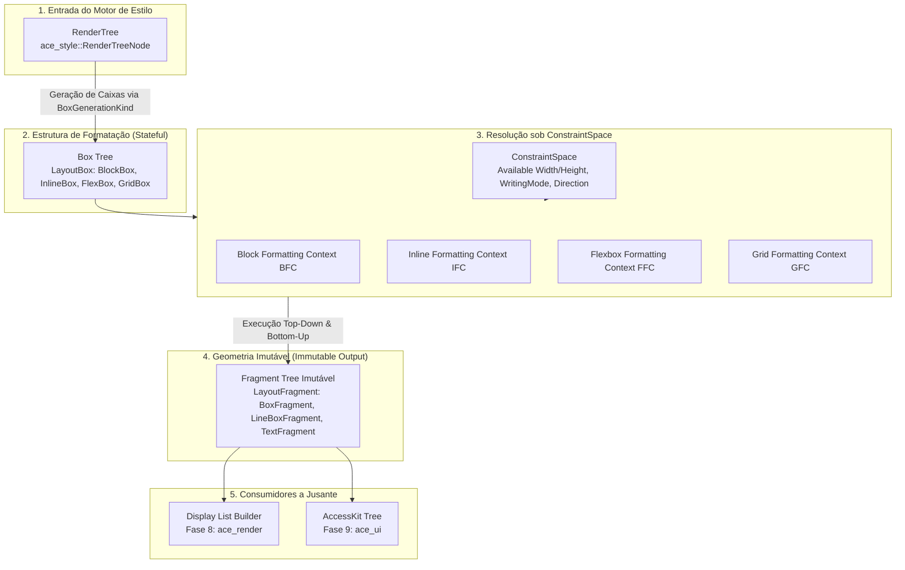

# 📐 Especificação Preliminar de Engenharia: Motor de Layout (`ace_layout`)

> **Documento:** `docs/architecture/ace_layout.md`  
> **Classificação:** Especificação Técnica Preliminar de Engenharia (Preliminary Engineering Specification)  
> **Crate:** `Albedo_Core_Engine/ace_layout` (Fase 7 do [PLANO.md](../../PLANO.md))  
> **Status:** 🎯 **Especificação Aprovada para Implementação** (Fase 7 Ativa)  
> **Padrões Normativos:** W3C CSS Display Module Level 3, CSS Box Model Module Level 3/4, CSS Inline Layout Module Level 3, CSS Flexible Box Layout Module Level 1, CSS Grid Layout Module Level 1, CSS Writing Modes Level 3, CSS Fragmentation Level 3/4.  
> **Inspiração Arquitetural:** *Chromium LayoutNG* (Blink 2.0), *Gecko Servo Flow Tree* (Mozilla).

---

## 📜 Histórico de Revisões e Governança

| Versão | Data | Contexto / Marco | Decisões & Escolhas Arquiteturais | Progresso & Mudanças |
| :---: | :---: | :--- | :--- | :--- |
| **0.1.0** | 2026-10-12 | Preparação Oficial da Fase 7 | • Arquitetura de Árvore Dupla: **Box Tree** mutável vs **Fragment Tree** imutável (paradigma LayoutNG).<br>• Eliminação de mutação no local (*in-place mutation*) para suporte a medições em múltiplos passos (Flexbox/Grid multi-pass).<br>• Adoção da aritmética de ponto fixo base 60 (`LayoutUnit`) de `ace_core`.<br>• Tipagem geométrica via `euclid 0.22` com suporte bidirecional e modos de escrita lógicos (`WritingMode`).<br>• Mapeamento de caixas a partir do contrato `BoxGenerationKind` do `ace_style`.<br>• Imposição de `#![forbid(unsafe_code)]`. | • Criação da especificação preliminar de engenharia para orientar os marcos da Fase 7. |

---

## 1. Visão Executiva & Metas da Fase 7

O subsistema **`ace_layout`** é responsável por converter a árvore de estilos abstratos gerada por `ace_style` (`RenderTree`) em uma representação geométrica física de fragmentos posicionados e dimensionados com precisão subpixel.

### 1.1 Metas Centrais de Engenharia
1. **Determinismo Numérico Absoluto:** Eliminar desvios acumulativos de ponto flutuante IEEE 754 através de ponto fixo de alta divisibilidade (`LayoutUnit` base 60).
2. **Separação entre Modelo de Formatação e Resultado Geométrico:** Desacoplar a hierarquia semântica de caixas CSS (**Box Tree**) das estruturas geométricas renderizáveis (**Fragment Tree** imutável).
3. **Isolamento de Contextos de Formatação:** Algoritmos autônomos para Bloco (BFC), Linha (IFC), Flexbox (FFC) e Grade (GFC), executados sob contratos de restrição geométrica (`ConstraintSpace`).
4. **Prontidão para Multithreading e Compositor:** A saída do layout é um grafo imutável envolvido em ponteiros compartilhados (`Arc<LayoutFragment>`), permitindo que a pintura (Fase 8: `ace_render`) e a acessibilidade (Fase 9: `ace_ui`) consumam os fragmentos concorrentemente sem risco de *data races*.

---

## 2. Arquitetura Dual: Box Tree vs Fragment Tree Imutável

A arquitetura do `ace_layout` adota a moderna abordagem em dois estágios consagrada pelo LayoutNG do Chromium e pelo motor do Servo:



### 2.1 Por Que Desacoplar Box Tree de Fragment Tree?

| Desafio de Layout Moderno | Limitação da Abordagem Clássica (Árvore Única Mutável) | Solução no Albedo (`ace_layout` Árvore Dupla) |
| :--- | :--- | :--- |
| **Layout Multi-Pass (Flex & Grid)** | O motor sobrescreve `x`, `y`, `width` e `height` na própria caixa durante passadas hipotéticas de medição (*measure pass*), corrompendo estados intermediários. | A **Box Tree** é preservada intacta; cada passada hipotética gera fragmentos descartáveis. Apenas a passada definitiva gera a **Fragment Tree** final. |
| **Fragmentação de Conteúdo (Line Breaking & Paginação)** | Um único parágrafo `<p>` ou elemento inline `<span>` pode quebrar em 5 linhas ou 2 páginas físicas. Em árvore única, a representação de múltiplos retângulos físicos exige truques de ponteiros. | A **Box Tree** mantém a caixa única conceitual; a **Fragment Tree** gera 5 nós `LineBoxFragment` físicos irmãos mapeados para a mesma caixa de origem. |
| **Concorrência e Thread-Safety** | Pintar a tela enquanto mutações ocorrem exige travas pesadas (*locks*) em cada nó para evitar inconsistências visuais (*tearing*). | A **Fragment Tree** gerada é completamente imutável e encapsulada em `Arc`. O renderizador pode pintar o frame anterior na GPU enquanto um novo frame é computado em background. |
| **Cache de Subárvores e Layout Incremental** | Recalcular nós vizinhos costuma invalidar propriedades geométricas de containers ancestrais. | Se as restrições de entrada (`ConstraintSpace`) não mudaram, fragmentos inteiros de subárvores são reutilizados instantaneamente em $O(1)$. |

---

## 3. Os Quatro Contextos de Formatação Normativos

O motor implementa isolamento formal para os quatro contextos estipulados no catálogo do MVP (`docs/scope/css_properties.md`):

### 3.1 Block Formatting Context (BFC)
- **Regras de Fluxo:** Caixas empilhadas verticalmente uma após a outra ao longo do eixo de bloco.
- **Margin Collapsing (Colapso Normativo de Margens):**
  - Margens verticais adjacentes entre caixas irmãs colapsam para `max(margin_a, margin_b)` quando ambas são positivas.
  - No caso de margens negativas: se ambas são negativas, o valor é `min(margin_a, margin_b)` (mais negativa); se uma for positiva e a outra negativa, o valor resultante é `margin_pos + margin_neg`.
  - Margens não colapsam através de bordas (*padding/border* $> 0$) ou quando um elemento estabelece um novo BFC.
- **Estabelecimento de Novo BFC:**
  Elementos com `overflow != visible`, `display: inline-block`, `display: flow-root`, itens flexíveis ou itens de grade estabelecem um BFC independente que contém suas próprias margens e impede o escape de flutuadores.

### 3.2 Inline Formatting Context (IFC)
- **Regras de Fluxo e Line Breaking:**
  Nós de texto puro (`RenderNodeKind::Text`) e elementos inline (`display: inline`) são desmembrados em sequências contíguas de caracteres (*TextRuns*) e empacotados horizontalmente em caixas de linha (`LineBoxFragment`).
- **Alinhamento Vertical e Baseline:**
  Cálculo das métricas tipográficas da fonte (ascent, descent, line-gap). Suporte rigoroso a `vertical-align: baseline` (alinhamento pela linha de base primária), `top`, `middle` e `bottom`.
- **Tratamento de Whitespace & Quebra:**
  Respeito às diretivas CSS `white-space: normal | nowrap | pre | pre-wrap`, compressão de sequências de espaços em branco e quebra forçada de palavras longas via `overflow-wrap: break-word` e `word-break`.
- **Texto Bidirecional (Bidi):**
  Reordenação de runs LTR/RTL para ordenação visual final na linha conforme o algoritmo Unicode Bidi.

### 3.3 Flexbox Formatting Context (FFC)
- **Eixos Principal (Main Axis) e Transversal (Cross Axis):**
  Definidos dinamicamente por `flex-direction: row | column | row-reverse | column-reverse`.
- **Resolução de Espaço Flexível:**
  1. Soma dos tamanhos base hipotéticos (`flex-basis`) dos itens.
  2. Determinação de espaço livre (*free space*) ou déficit (*overflow*).
  3. Distribuição proporcional de crescimento baseada no fator ponderado `flex-grow` ou encolhimento proporcional baseado em `flex-shrink * flex-basis`.
- **Alinhamento e Distribuição:**
  - `justify-content`: `flex-start`, `flex-end`, `center`, `space-between`, `space-around`, `space-evenly`.
  - `align-items` e `align-self`: `stretch`, `flex-start`, `flex-end`, `center`, `baseline`.
  - `align-content` para contêineres multi-linha (`flex-wrap: wrap`).
- **Calhas e Espaçamentos:** Resolução de `gap` (`row-gap` e `column-gap`).

### 3.4 Grid Formatting Context (GFC)
- **Estrutura de Trilhas do MVP:**
  Resolução de matriz 2D bidimensional a partir de `grid-template-columns` e `grid-template-rows`.
- **Tipos de Dimensionamento de Trilhas:**
  - Comprimentos fixos (`px`) convertidos para `LayoutUnit`.
  - Percentuais (`%`) resolvidos contra o tamanho interno do contêiner.
  - Unidades flexíveis fracionárias (`fr`): divisão equitativa do espaço remanescente pós-trilhas fixas.
  - Palavras-chave: `auto` e funções de restrição `minmax(min, max)`.
- **Posicionamento de Células:**
  Mapeamento de itens por linhas explícitas (`grid-column-start`, `grid-column-end`, `grid-row-start`, `grid-row-end`) e posicionamento automático ordenado por fluxo (`grid-auto-flow: row | column`).
- **Resolução de Calhas:** Aplicação direta de `gap`.

---

## 4. Fundação Numérica: Aritmética de Ponto Fixo (`LayoutUnit`)

O `ace_layout` utiliza como tipo numérico atômico a struct `LayoutUnit` (implementada em `ace_core::math::layout_unit`):

```rust
// Albedo_Core_Engine/ace_core/src/math/layout_unit.rs

pub const UNITS_PER_PIXEL: i32 = 60;

#[derive(Clone, Copy, PartialEq, Eq, PartialOrd, Ord, Hash, Default)]
pub struct LayoutUnit(pub i32);
```

### 4.1 Por Que Base 60?
$1 \text{ pixel CSS} = 60 \text{ LayoutUnits}$ ($1/60$ de pixel).
O número 60 é o menor inteiro com alta divisibilidade exata pelos fatores:
$$\{2, 3, 4, 5, 6, 10, 12, 15, 20, 30\}$$
Em algoritmos de layout, divisões por 3 (colunas em terços) ou 5 geram dízimas periódicas infinitas em ponto flutuante binário IEEE 754 (ex: $100 / 3 = 33.333333\dots$). Em ponto fixo base 60, divisões por 3 ou 5 são **exatamente representáveis em números inteiros sem resíduo**:
$$1 \text{ px} / 3 = 20 \text{ au}, \quad 1 \text{ px} / 5 = 12 \text{ au}$$

### 4.2 Aritmética Saturada e Pixel Snapping
- **Aritmética Saturada:** Operações aritméticas usam métodos intrínsecos saturantes (`saturating_add`, `saturating_sub`, `saturating_mul`), prevenindo *integer overflow panics* ou distorções de coordenadas diante de páginas com tamanhos abusivos.
- **Pixel Snapping (`snap_box`):** Durante a geração dos fragmentos para renderização na GPU, as bordas fracionárias são arredondadas para pixels físicos inteiros da tela mantendo as larguras intactas, evitando artefatos visuais borrados (*subpixel fuzziness*):
  ```rust
  pub fn snap_box(origin: LayoutUnit, size: LayoutUnit) -> (i32, i32) {
      let start_px = (origin.0 + UNITS_PER_PIXEL / 2) / UNITS_PER_PIXEL;
      let end_px = (origin.0 + size.0 + UNITS_PER_PIXEL / 2) / UNITS_PER_PIXEL;
      (start_px, (end_px - start_px).max(0))
  }
  ```

---

## 5. Tipagem Geométrica Forte via `euclid` e Modos de Escrita Lógicos

Em conformidade com o ADR-0017, o layout opera sobre unidades parametrizadas tipadas da crate `euclid 0.22`:

```rust
use ace_core::math::layout_unit::LayoutUnit;
use ace_core::math::units::LayoutPixel;

pub type LayoutPoint      = euclid::Point2D<LayoutUnit, LayoutPixel>;
pub type LayoutSize       = euclid::Size2D<LayoutUnit, LayoutPixel>;
pub type LayoutRect       = euclid::Rect<LayoutUnit, LayoutPixel>;
pub type LayoutEdgeInsets = euclid::SideOffsets2D<LayoutUnit, LayoutPixel>;
```

### 5.1 Abstração de Modos de Escrita Lógicos (W3C CSS Writing Modes L3)
O motor de layout não computa coordenadas absolutas `top/left/width/height` diretamente nos loops internos de formatação; ele opera em termos dos eixos lógicos:
- **`inline`:** Eixo paralelo à linha de texto.
- **`block`:** Eixo perpendicular à linha de texto (direção de empilhamento de parágrafos).

```rust
// Albedo_Core_Engine/ace_core/src/math/logical.rs

pub struct LogicalPoint<T> {
    pub inline: T,
    pub block: T,
}

pub struct LogicalSize<T> {
    pub inline_size: T,
    pub block_size: T,
}

pub struct LogicalRect<T> {
    pub inline_start: T,
    pub block_start: T,
    pub inline_size: T,
    pub block_size: T,
}

pub struct LogicalSides<T> {
    pub inline_start: T,
    pub inline_end: T,
    pub block_start: T,
    pub block_end: T,
}
```

### 5.2 Conversão Bidirecional para Coordenadas Físicas
A conversão final para coordenadas da janela do dispositivo é governada pelo enum `WritingMode` e `Direction`:
- Modos suportados: `HorizontalTb`, `VerticalRl`, `VerticalLr`, `SidewaysRl`, `SidewaysLr`.
- Direções suportadas: `Direction::Ltr` e `Direction::Rtl`.
- O método `LogicalRect::to_physical(wm, dir, container_size)` mapeia as dimensões lógicas para o `LayoutRect` final da GPU em tempo $O(1)$.

---

## 6. Mapeamento de Caixas a partir do `ace_style` (`BoxGenerationKind`)

O contrato formal de integração entre `ace_style` e `ace_layout` é materializado pelo enum `BoxGenerationKind` presente em cada nó da `RenderTree`:

```rust
// Albedo_Core_Engine/ace_style/src/engine/style_engine.rs

pub enum BoxGenerationKind {
    /// display: block
    Block,
    /// display: inline
    Inline,
    /// display: inline-block
    InlineBlock,
    /// display: flex
    Flex,
    /// display: grid
    Grid,
    /// Pseudo-elementos ::before e ::after
    Anonymous,
    /// Segmento de texto puro
    TextRun,
}
```

### 6.1 Tabela de Transição: Nó de Renderização $\to$ Caixa de Layout

| `BoxGenerationKind` | Tipo de Caixa Gerada na Box Tree | Contexto de Formatação Estabelecido | Tratamento de Filhos |
| :--- | :--- | :--- | :--- |
| **`Block`** | `BlockBox` | BFC (ou propaga BFC existente) | Empilhamento vertical; colapso de margens. |
| **`Inline`** | `InlineBox` | IFC | Fragmentado em `LineBoxFragment` com text runs. |
| **`InlineBlock`** | `InlineBlockBox` | Estabelece novo BFC independente | Tratado externamente como inline, internamente como bloco. |
| **`Flex`** | `FlexBox` | FFC | Filhos tornam-se itens flexíveis independentes. |
| **`Grid`** | `GridBox` | GFC | Filhos mapeados para trilhas e células da grade. |
| **`Anonymous`** | `AnonymousBox` | Determinado pelo container pai | Caixas geradas para isolar nós inline vizinhos a blocos ou `::before`/`::after`. |
| **`TextRun`** | `TextRunBox` | IFC | Texto semântico medido e formatado na linha. |

---

## 7. Estruturas de Dados Previstas para a Implementação da Fase 7

A implementação concreta em `Albedo_Core_Engine/ace_layout` estruturará os seguintes tipos centrais:

```rust
// Esboço dos contratos do módulo ace_layout

/// Restrições espaciais impostas pelo pai ao formatar uma caixa filha
pub struct ConstraintSpace {
    pub available_size: LogicalSize<Option<LayoutUnit>>,
    pub percentage_resolution_size: LogicalSize<LayoutUnit>,
    pub writing_mode: WritingMode,
    pub direction: Direction,
    pub is_new_fc: bool,
}

/// Fragmento físico imutável produzido pelo layout
pub struct LayoutFragment {
    pub node_id: NodeId,
    pub physical_rect: LayoutRect,
    pub content_rect: LayoutRect,
    pub padding: LayoutEdgeInsets,
    pub border: LayoutEdgeInsets,
    pub margin: LayoutEdgeInsets,
    pub children: Vec<Arc<LayoutFragment>>,
}

/// Árvore imutável final pronta para consumo pela pintura
pub struct FragmentTree {
    pub root: Arc<LayoutFragment>,
    pub viewport_size: LayoutSize,
}
```

---

## 8. Critérios de Aceite e Roteiro de Verificação da Fase 7

1. **Compilação e Linter:**
   - Crate compilado sob `#![forbid(unsafe_code)]`.
   - Zero warnings com `cargo clippy -p ace_layout --all-targets -- -D warnings`.
2. **Conformidade Geométrica:**
   - Testes unitários para colapso de margens positivas, negativas e mistas em BFC.
   - Testes de quebra de linha com textos longos e `white-space: nowrap` em IFC.
   - Testes de distribuição flexível com `flex-grow` e `flex-shrink` em FFC.
   - Testes de posicionamento de trilhas em GFC com unidades `fr` e `minmax`.
3. **Determinismo Numérico:**
   - Asserções de snapping e zero divergência subpixel acumulada após 1.000 iterações em layouts aninhados.
